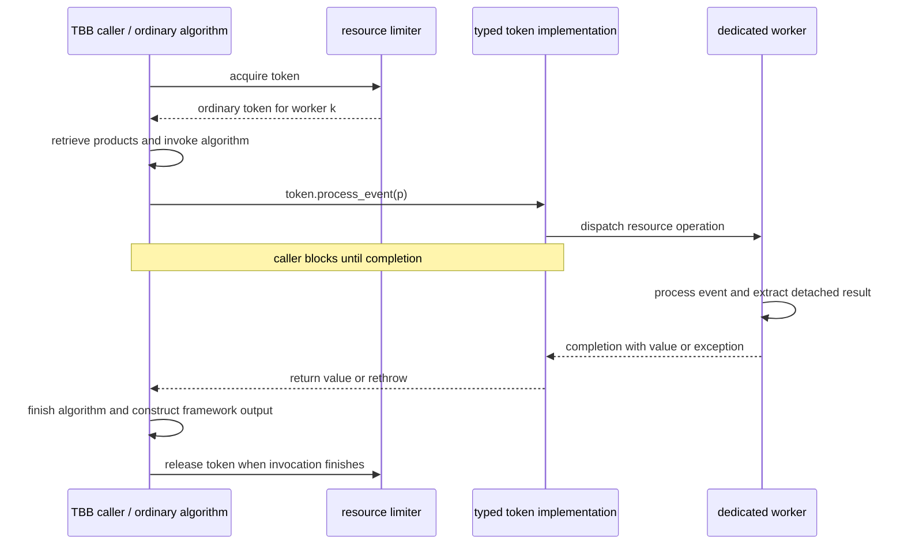

# Geant4 as a thread-affine pooled resource: evaluation and proposal

*Status: revised design proposal, November 2026. Algorithms receive ordinary
resource tokens with typed synchronous methods. The revised mock passes the
configured workspace's 195 CTests; the resource test also passed 50 consecutive
runs. No actual Geant4 backend has been built or run.*

This note follows
[geant4-pinned-thread-resource-2026-07.md](geant4-pinned-thread-resource-2026-07.md).
The original evaluation examined branch `pinned-thread-resource` (staged changes
on top of `2b6005e4`) and Geant4/CMSSW `master` sources. Those observations are
preserved below as historical analysis, not a fresh source review or validation
of the revised implementation.

The old `geant4_worker_pool`, broadcast hooks, and per-run lifecycle tests have
been removed. The subsequent direct-handle/whole-node handoff proposal is also
superseded. Neither design is the current algorithm-facing contract.

## Summary

- Ordinary `g.transform` algorithms receive a token and call typed synchronous
  methods such as `token.process_event(p)` to obtain detached results.
- The resource implementation dispatches that operation to its dedicated worker.
  Algorithms submit no execution lambdas and receive no raw Geant4 handle.
- The framework performs ordinary token checkout and forwarding. It does not
  hand off the entire algorithm or node body, detect a `thread_affine_token`
  concept, substitute handles, or impose a single-affine-resource limit.
- Private callable-based `execute` uses semaphores, caller-local optional value
  storage, and `std::exception_ptr`. It supports `void` and move-only values,
  but not reference returns. It uses no standard futures or asynchronous tasks.
- One Geant4 run for the life of the resource is a separate, unvalidated backend
  proposal. It is not required by the generic token interface or proved by mocks.
- A kernel-level backend would depend on Geant4 internals rather than the stock
  run manager's documented worker-thread orchestration.

## Historical adapter evaluation

These findings concern the obsolete staged adapter, not the revised mock API.

### Useful findings

- **Checkout and lifetime.** N pooled tokens can represent N workers. The
  framework resource lifetime encloses graph operations, which is the needed
  ownership shape for non-owning tokens. Tokens must not escape their checkout.
- **Generic transport.** Internal `execute(operation)` avoids event-signature
  deduction and keeps owned worker state on its dedicated thread. The revised
  design retains this as a resource implementation detail, not a public token
  execution interface.
- **Master ownership.** The earlier reading of `phlex/app/run.cpp` identified
  resource construction and destruction on the calling thread. A Geant4 backend
  must preserve master construction/destruction affinity and keep master and
  workers in one object; the resource catalog's unordered destruction order
  cannot supply that ordering between separate resources.
- **Concrete resource identity.** The catalog is keyed by resource type. A
  concrete class can be named by plugins; a specialization on a local lambda
  factory is not an appropriate public resource type.

### Why the old per-run adapter did not fit

1. **No caller for `begin_run` and `end_run`.** The registered pool was private
   inside `pooled_resource_entry`, with no resource lifecycle hooks. The adapter
   would remain idle and reject events.
2. **No per-run drain.** The earlier evaluation of `data_cell_tracker.cpp` and
   `framework_graph.cpp` found run closure on arrival of the next run's index
   and job-wide waits, not serialized Geant4 run transitions. Events from
   different Phlex runs can overlap.
3. **Manual tests bypassed integration.** The old test used a raw
   `flow::resource_limiter` and called `begin_run`, `wait_for_all`, and `end_run`
   manually rather than exercising `add_pooled_resource`.
4. **No result path.** Its `void process_event` and `void execute` could not
   provide transform results. The correction is typed value returns, not direct
   Geant4 pointer exposure. Hiding the Geant4 object is desirable.

The later whole-node handoff evaluation is obsolete as well. Any earlier
verification of direct-handle algorithms does not validate ordinary-token
algorithms or the revised thread boundary.

## Why a raw Geant4 pointer is not the interface

The algorithm runs on whichever TBB thread invokes it. Exclusive resource
checkout does not change thread identity. Returning a raw pointer from a token,
even if obtaining that pointer involved a handoff, cannot redirect a subsequent
`g4->ProcessOneEvent(...)` member call to the worker.

The earlier source analysis found `G4EventManager::fpEventManager` and
`G4RunManagerKernel::fRunManagerKernel` to be `G4ThreadLocal`. It also found a
thread-local allocator dereference without a null check in
`G4Event::operator delete`. Wrong-thread use and destruction can therefore fail
even while the caller holds exclusive access to the pointer.

The typed resource method must create/use/destroy thread-affine Geant4 objects
and extract detached results on the worker. No Geant4 pointer, reference, or
object requiring worker-thread destruction should escape. The generic transport
cannot prove that an arbitrary returned value is detached; the concrete resource
API is responsible for that contract.

## Typed synchronous token design

### User view

```cpp
// API sketch only; not compiled and not a real Geant4 test.
g.transform(
   "simulate",
   [](primaries const& p, geant4_simulation::token_type token) -> sim_hits {
     return token.process_event(p);
   },
   concurrency::unlimited)
  .input_family(product_selector{.creator = "generator", .layer = "event"},
                resource<geant4_simulation>{});
```

This lambda is the ordinary registered algorithm, not an execution callback
submitted to the token. The token's public API is a typed method such as
`sim_hits process_event(primaries const&) const`; there is no public `execute`,
`run_on_thread`, or Geant4 pointer accessor. Algorithms can prepare inputs and
use results without knowing how the resource schedules its work.

### Thread boundary



The resource call is synchronous, so checkout remains active until the worker
has finished with the operation's inputs and completion storage. Product
retrieval, the algorithm itself, and output product-store construction remain on
the invoking thread. Only code inside the typed resource operation runs on the
dedicated thread. There is no whole-node or whole-algorithm handoff.

`invoke_with_resources` continues ordinary token forwarding, without affinity
introspection or a special limit on the number of such resources in an algorithm.
Each resource method handles its own dispatch. A token copy neither extends a
lease nor authorizes concurrent use of a worker outside the limiter.

### Internal transport contract

A concrete resource may privately call `managed_thread::execute(operation)`
through its worker handle. Callable submission belongs only to the resource
implementation and low-level transport tests, never the algorithm-facing token.

1. The caller prepares a local operation and, for a non-void result, local
   `std::optional<Result>` storage. The transport publishes the operation through
   its single callable slot and signals the worker with a semaphore.
2. The worker invokes the operation against its owned state and emplaces the
   result into that caller-local storage. It captures failures in
   `std::exception_ptr` and signals completion in either case.
3. The caller waits on the completion semaphore before inspecting the result or
   exception. The local operation, inputs borrowed by it, and result storage must
   remain alive throughout the wait. After completion, the caller rethrows a
   captured exception or moves out the value.
4. `void` uses completion and exception transport without optional value
   storage. Move-only values are supported. Reference returns are rejected;
   references into worker-owned state must not escape.

No `std::future`, `std::promise`, `std::packaged_task`, or `std::async` participates
in this design. It has no fire-and-forget path. Captures and detached results can
be destroyed on the caller, so they cannot own worker-affine Geant4 objects.
Exception transport does not imply that a failed Geant4 worker is recoverable.

The synchronous wait parks a TBB caller while the dedicated thread runs. N busy
workers can mean N blocked callers plus N active dedicated threads. This is a
scheduling cost, not a guarantee that overall runnable threads remain within
TBB's configured parallelism.

## Separate backend proposal: job-long Geant4 run

The following lifecycle is an assumption for a future concrete
`geant4_simulation` resource in a Geant4-dependent library, outside `phlex::core`.
It is neither a generic resource requirement nor a validated Geant4 integration.

| Lifecycle step | Proposed location |
| --- | --- |
| Master geometry, physics, kernel initialization | Resource constructor, on its creating thread, before workers |
| Worker split-class workspaces, kernel, detectors, actions | Worker factory on the dedicated thread |
| Begin the single job-long Geant4 run | Worker setup on the dedicated thread |
| Event, RNG/context installation, result extraction | Typed token operation dispatched to the worker |
| End the Geant4 run and tear down worker state | On the dedicated thread before joining |
| Master teardown | Resource destruction on its creating thread, after all workers |

Master and workers must belong to one resource object, with the master destroyed
last. Factories and teardown that proceed one worker at a time cannot implement
a collective barrier without additional backend coordination. Non-throwing
teardown must also cover partial initialization.

Under this assumption, no Phlex begin-run/end-run hooks are added. Geant4 run
actions correspond to the job-long run, not each Phlex run. Algorithms obtain
run-level information through parent-layer products and provide relevant data
to typed token methods. Folds produce per-run summaries but complete only for
their own inputs and pending invocations, not as a global worker drain.

Token assignment to workers is arbitrary. A backend aiming for event-based
reproducibility must install appropriate RNG state on the worker for each event;
reproducibility is not established by the token design. Geometry and physics
would come from configuration before data flows. Run-dependent geometry or
Geant4 actions for every Phlex run require a different lifecycle design.

## Geant4 evidence and caveats

These are observations from the earlier upstream reading, not tested support
claims for this proposal.

| Piece | Earlier observation and remaining limitation |
| --- | --- |
| Stock `G4MTRunManager` / `G4WorkerRunManager` | Master owns threads; workers pull events within `BeamOn`, and run transitions use barriers. This is not the proposed caller-owned-worker route. |
| Kernel-level event processing | CMSSW uses `G4MTRunManagerKernel`, `G4WorkerRunManagerKernel`, and `G4EventManager::ProcessOneEvent`. The required initialized state and lifecycle still need backend validation. |
| One run for the entire Phlex job | Proposed assumption, not established by a mock or by observing a single-run CMSSW path. |
| Shared geometry, materials, cuts, physics tables | Updates require coordinated stopped workers. A Phlex fold is not that coordination. |

The earlier CMSSW reading identified worker setup involving
`G4WorkerThread::BuildGeometryAndPhysicsVector()`, `WorkerDefineWorldVolume`,
physics-list worker initialization, and `RunInitialization`. This is useful
precedent, not a complete recipe. The Geant4 developer guide says users should
never instantiate workers directly; the kernel-level route is coupled to
internals outside the documented user interface.

Stock user-initialization classes cannot be assumed to drop in.
`G4VUserActionInitialization::SetUserAction` forwards through
`G4RunManager::GetRunManager()`. The earlier analysis did not inspect that
accessor and did not establish behavior without a worker run manager. CMSSW's
direct action registration on `G4EventManager` is another backend obligation.

The earlier reading found that CMSSW's first `globalEndRun` stops the master and
cleans the physical-volume store, later `initG4` returns early, and worker
`terminateRun` deletes the run action and permanently sets `runTerminated`.
No exercised multi-run path was identified. This does not validate mapping many
Phlex runs onto a single Geant4 run. Lazy worker-local run switching is not an
adopted fallback: overlapping Phlex runs would not yield reliable end-of-run
boundaries or a barrier for shared state.

Further backend caveats remain:

- **Stack size.** The examined CMSSW handoff uses configurable pthread stacks,
  defaulting to 10 MiB. `std::jthread` offers no portable stack-size control;
  Geant4 may need a pthread-backed or platform-specific implementation.
- **Cleanup affinity and ownership.** Geant4 objects must obey their allocation,
  TLS, and ownership rules. Do not assume every `G4AutoDelete` or singleton is
  cleaned up at thread exit, or delete objects owned by Geant4 cleanup machinery.
- **Errors.** C++ exception transport does not cover all Geant4 error handling
  or establish safe reuse after failure. CMSSW's exception handler was not
  examined in the earlier analysis.
- **Services and RNG.** Context needed by backend code must be installed inside
  the typed worker operation. Ordinary token forwarding does not carry TLS or
  service registries across threads.
- **Unexamined alternatives.** `G4TaskRunManager` was not evaluated. No claim
  about its suitability follows from this proposal.

## Mock scope and validation status

The revised mock in
`test/tbb-preview/resource_limited_threads_test.cpp` exposes:

- `token.process_event(unsigned)`, returning a detached struct containing the
  computed value and the worker thread ID, rather than a worker pointer.
- `token.fail()`, which dispatches an operation that throws on the worker and
  rethrows the exception on the synchronous caller.

Integration tests use real framework ordinary-token algorithms through
pooled-resource registration. A helper node-body test checks the thread boundary:
the node body stays on its caller while the typed method operates on the worker.
The worker ID in a returned value makes that distinction observable without
exposing worker-owned state.

On November 16, 2026, `scripts/verify.sh --build-dir build` rebuilt the configured
workspace and passed all 195 CTests. The revised resource test also passed
`ctest --repeat until-fail:50`. Coverage includes two Phlex runs, mixed resource
types, caller/worker boundaries, `void` and move-only results, exception delivery
and transport reuse, and worker initialization/destruction affinity. Reference
returns are rejected by a compile-time assertion; there is no negative compile
test for that assertion.

An earlier repeated run with multiple failing events exposed an intermittent
segmentation fault in the installed TBB preview's
`resource_limited_body_leaf::remove_request`, reached from task cancellation.
The graph-level exception test now supplies one event to isolate exception
delivery and worker reuse from queued-request cancellation. This is not a fix
for concurrent graph cancellation; that dependency path remains unresolved.
To reproduce the observed setup, change the exception test's
`add_events(graph, 1, 1)` to `add_events(graph)` and repeat the resource test.

No real Geant4 has been tested. Mock results cannot establish correct Geant4
initialization, job-long-run semantics, stack sufficiency, RNG reproducibility,
failure recovery, or cleanup. Those remain backend validation work, not changes
to ordinary framework token forwarding.
